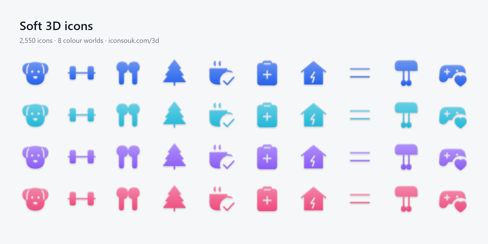

# Soft 3D icons

2,550 free icons with a soft, rounded 3D look by [Novissium](https://novissium.com) – in 8 colour worlds.

Browse, search and download on **[iconsouk.com/3d](https://iconsouk.com/3d/)** – also as React, Vue and CSS.



## Colour worlds

Every icon exists in eight colours, each in its own folder with the same file names:

| Colour | Folder |
|---|---|
| Cobalt | `svg/cobalt/` |
| Cyan | `svg/cyan/` |
| Violet | `svg/violet/` |
| Pink | `svg/pink/` |
| Gold | `svg/gold/` |
| Rose gold | `svg/rosegold/` |
| Silver | `svg/silver/` |
| Holo | `svg/holo/` |

```
svg/cobalt/animals/bear.svg
svg/gold/animals/bear.svg
```

## Usage

- SVG with `viewBox="0 0 24 24"`, gradients built in – they look the same everywhere, no CSS needed.
- They scale cleanly from small UI sizes up to large feature graphics.

## Topics

Animals, arrows, buildings, charts, communication, currency, development, devices, education, events, files, food, health, house, interface, kitchen, light, media, mobility, nature, office, people, science, security, shapes, shop, sport, text, tools, travel, wear and weather.

## More icons

58,000+ free icons in 33 sets on [iconsouk.com](https://iconsouk.com)

## License

The icons in this repository are licensed under [Creative Commons Attribution 4.0 International (CC BY 4.0)](https://creativecommons.org/licenses/by/4.0/).

You may use, share and adapt them, also commercially, as long as you give credit:

> Icons: Soft 3D from iconsouk.com – by Novissium (novissium.com)
